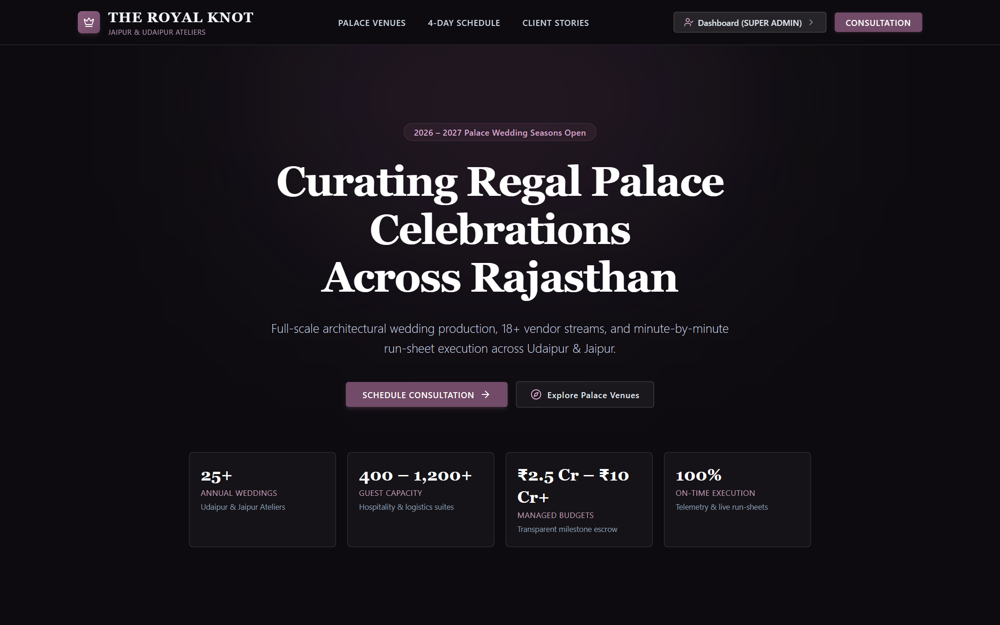
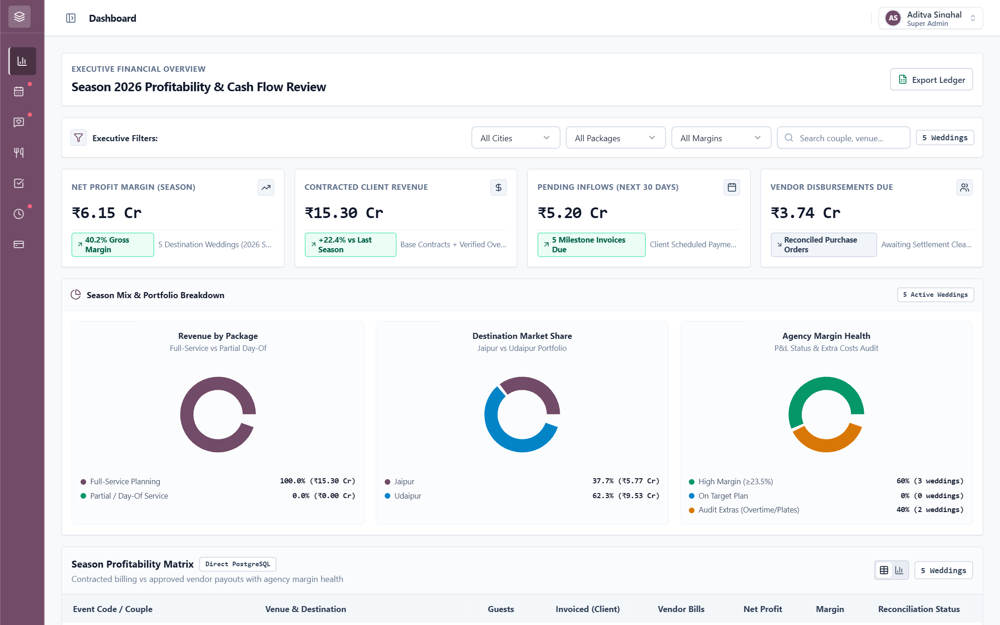
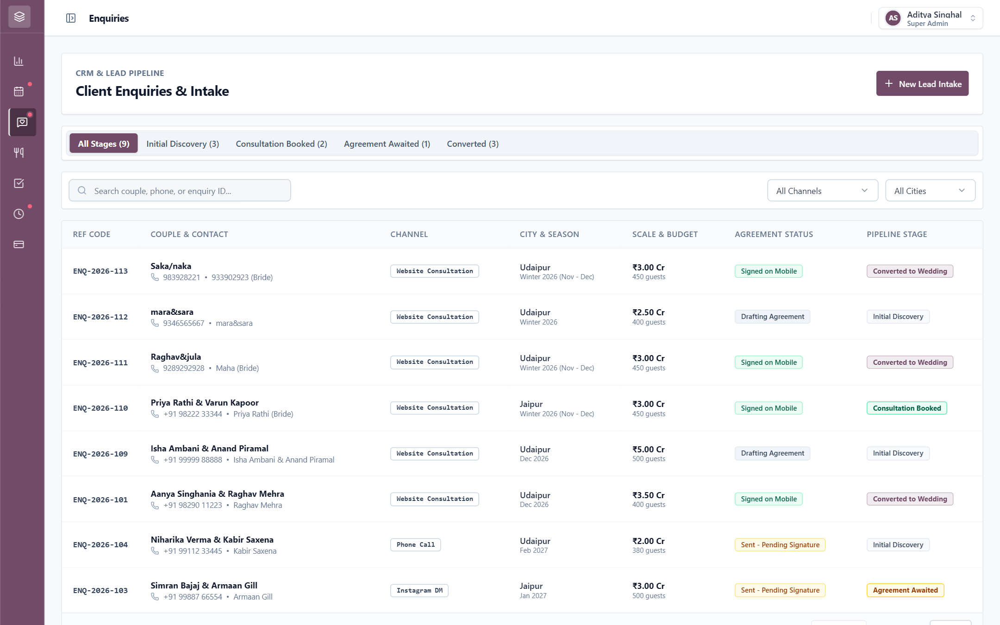
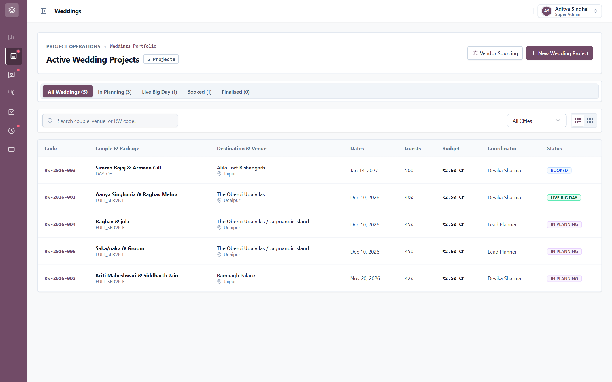
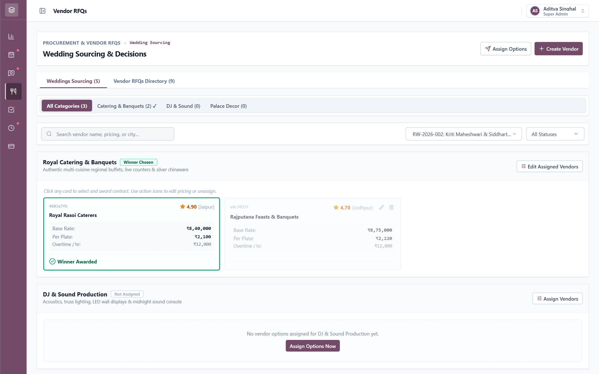
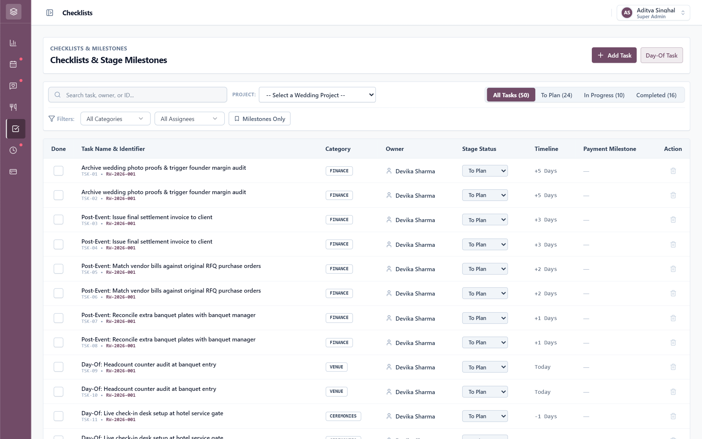
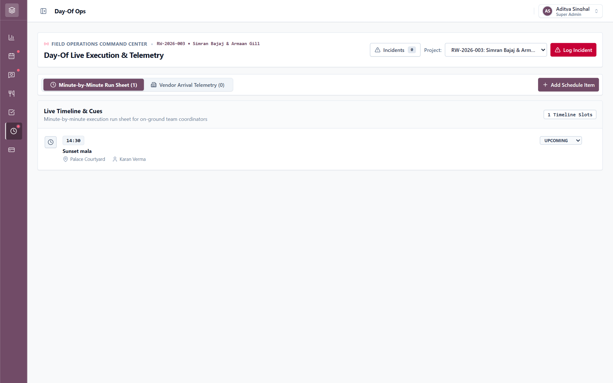
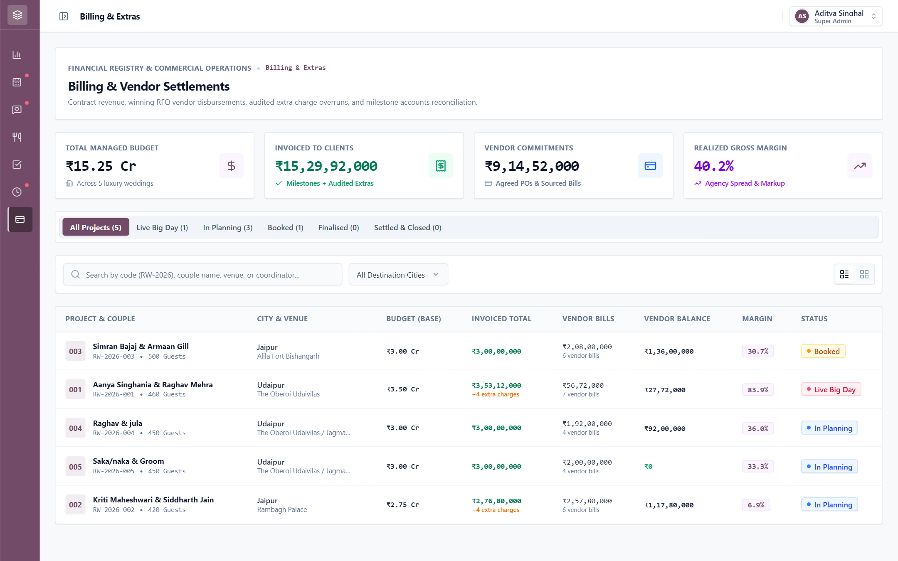
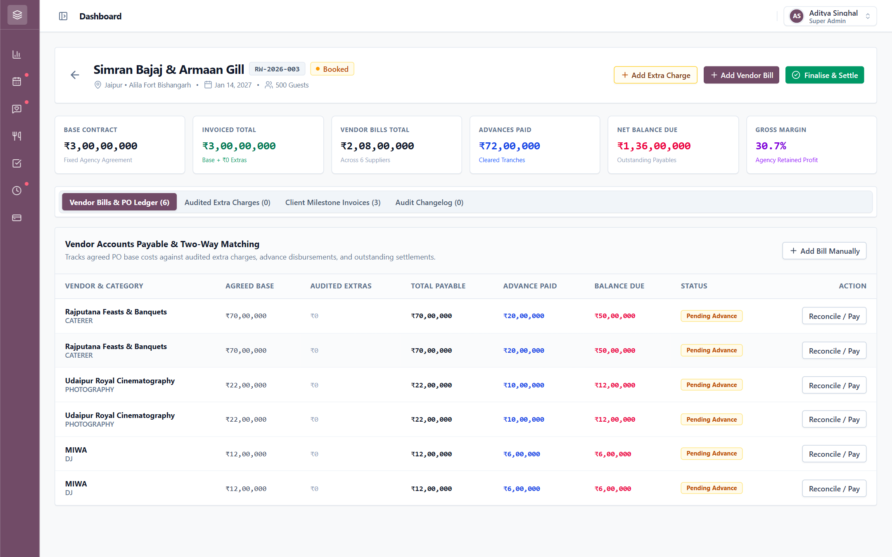

# The Royal Knot — Luxury Wedding Planning Operating System

> *"Running 25 luxury destination weddings across Jaipur and Udaipur via frantic WhatsApp groups and scribbled paper diaries is not 'rustic charm'—it is an impending operational cardiac event."*

**The Royal Knot** is a unified digital operating system engineered for high-end luxury wedding planning agencies in Rajasthan. Every season, the atelier orchestrates ~25 multi-day royal weddings across Jaipur, Udaipur, and Jodhpur with **400+ guests**, **18+ specialized vendors**, multi-day traditional ceremonies (Mehendi, Sangeet, Vedic Pheras, Grand Reception), and **multi-crore budgets**.

---

## 🎯 The Core Business Problem

High-end destination weddings have thousands of moving parts across months of planning and high-stakes live execution:

| The Old Way (Chaotic Reality) | The Royal Knot Solution |
| :--- | :--- |
| **Lost Inquiries:** Couples reach out on WhatsApp, phone calls, and Instagram DMs, and leads get forgotten. | **Unified Intake Pipeline:** Instant capture from public inquiry or manual entry, tracked to a single CRM record. |
| **Manual Quote Comparisons:** 3 caterers send inconsistent PDFs on WhatsApp, compared by hand. | **Side-by-Side RFQ Matrix:** Normalized rate-per-plate, overtime clauses, and 1-click winner award. |
| **Diary Checklists:** Planners rewrite 25+ repetitive tasks into paper notebooks for every new wedding. | **Instant Wedding Blueprint:** Automated 25+ task checklist across ceremony stages with due-date tracking. |
| **Big-Day Live Chaos:** Late DJ, missing generator, bride car delayed in traffic with zero real-time visibility. | **Big Day Command Center:** Live minute-by-minute run sheet, vendor arrival board, and incident dispatcher. |
| **Financial Leakage:** 60 unexpected guests attend banquet; vendor advances forgotten, invoices duplicated. | **Two-Way Bill Matching & Extra Plates Audit:** Headcount reconciliation and matched vendor purchase orders. |
| **Post-Season Guessing:** Founder only discovers which weddings were actually profitable months later. | **Founder Season Intelligence:** Real-time wedding-by-wedding P&L matrix, margins, and cash flow forecast. |

---

## 📸 Visual Tour & Core Module Walkthrough

Here is how each operational module functions inside The Royal Knot operating system:

### 1. Luxury Public Experience & Couple Intake (`/`)
*Curating regal palace celebrations across Rajasthan with seamless lead intake.*

- **What it does:** Serves as the digital front door for prospective couples. Showcases curated palace venues across Udaipur and Jaipur, a 4-day traditional celebration timeline, client testimonials, and a streamlined consultation booking form.
- **Key Capabilities:**
  - Zero upfront login friction for prospective clients.
  - Comprehensive Zod validation on guest counts, destination cities, and contact details.
  - Immediate ingestion into the planner's CRM pipeline.

---

### 2. Founder Season Intelligence & P&L Margins (`/dashboard`)
*Executive oversight across all 25 luxury weddings, net margins, and cash flow.*

- **What it does:** Gives agency founders and leadership instant visibility into total contracted revenue, upcoming 30-day cash inflows, committed vendor disbursements, and realized net profit margins across the season.
- **Key Capabilities:**
  - Real-time P&L status: Contracted revenue vs. vendor bills vs. agency spread.
  - Interactive portfolio breakdowns by destination city (Jaipur vs. Udaipur) and service tier.
  - 1-click Excel/CSV ledger export for accountants and stakeholders.

---

### 3. CRM Lead Pipeline & Client Intake (`/enquiries`)
*Consolidated lead capture across website inquiries, WhatsApp, and phone calls.*

- **What it does:** Unifies inbound client leads across all acquisition channels into structured pipeline stages (`Initial Discovery`, `Consultation Booked`, `Agreement Awaited`, `Converted to Wedding`).
- **Key Capabilities:**
  - Live count tabs matching the Odoo ERP workflow with Royal Plum branding.
  - Channel tags (Website Consultation, WhatsApp, Instagram DM, Phone Call).
  - One-click lead conversion into an active wedding project with digital contract dispatch.

---

### 4. Active Wedding Projects Registry (`/weddings`)
*Centralized command for active royal weddings in planning and execution.*

- **What it does:** Manages all active weddings with details on couple names, destination palace venues, event dates, guest counts, managed budgets, and assigned lead field coordinators.
- **Key Capabilities:**
  - Filterable by operational stage: `Live Big Day`, `In Planning`, `Booked`, and `Finalised`.
  - Destination city segmentation (Jaipur, Udaipur, Jodhpur).
  - Quick action to open wedding dossiers, assign coordinators, or initiate vendor procurement.

---

### 5. Procurement, Curated Vendors & 3-Way RFQ Sourcing (`/procurement`)
*Standardized vendor quotes, side-by-side matrices, and 1-click contract awards.*

- **What it does:** Eliminates chaotic WhatsApp PDF comparisons. Normalizes caterer, decorator, and sound quotes into standard rates per plate, overtime rates, and deliverables.
- **Key Capabilities:**
  - Side-by-side comparative RFQ matrix across 3 competing suppliers.
  - 1-click winner award that binds the selected quote directly to the wedding's procurement ledger while auto-closing competing bids.
  - Curated vendor directory with ratings, city specialties, and verified contact telemetry.

---

### 6. 25+ Task Master Checklist & Blueprint Planner (`/tasks`)
*Automated operational checklists generated when booking deposits are confirmed.*

- **What it does:** Replaces paper notebooks with an automated 25+ milestone task master template covering permits, venue blueprints, menu tastings, priest alignment, and live-day setups.
- **Key Capabilities:**
  - Dual stream: Long-range milestone planning and live Day-Of exact-time task scheduling.
  - Multi-category classification (`FINANCE`, `VENUE`, `VENDORS`, `DESIGN`, `PERMITS`, `CEREMONIES`).
  - Strict owner assignment and linked stage payment triggers.

---

### 7. Big Day Live Command Center & Incident Telemetry (`/day-of`)
*Real-time run sheet, vendor dispatch telemetry, and rapid crisis incident logging.*

- **What it does:** The mission-critical mobile command dashboard for on-ground palace coordinators during the live celebration.
- **Key Capabilities:**
  - Minute-by-minute execution run sheet (florist setup, baraat escort, varmala cue, banquet start).
  - Vendor gate check-in telemetry flagging scheduled vs. actual arrival times and delay minutes.
  - Urgent incident logger with severity badges and rapid firefighter assignment (e.g. auxiliary generator dispatch).

---

### 8. Commercial Billing, PO Ledger & Settlements (`/billing`)
*Financial registry, staged milestone billing, and vendor settlement tracking.*

- **What it does:** Manages commercial operations across all luxury weddings, tracking contract values, client billings, winning vendor purchase orders, and agency gross margins.
- **Key Capabilities:**
  - Unified Odoo ERP pipeline tabs with live project counts.
  - Executive financial cards: Managed budget, client billings, vendor commitments, and agency spread.
  - Quick switch between high-density table view and visual project cards.

---

### 9. Project Billing Dossier & 3-Way Reconciliation (`/billing/:id`)
*Detailed accounts payable, audited extra charges, and client milestone invoices.*

- **What it does:** The definitive financial single source of truth for each wedding project.
- **Key Capabilities:**
  - **Vendor Bills & PO Ledger:** 3-way matching of agreed quotes against submitted vendor claims and advance disbursements.
  - **Audited Extra Charges:** Headcount audit log capturing overruns (e.g. +60 banquet plates @ ₹2,100, +2 hrs DJ overtime) with itemized notes.
  - **Client Milestone Invoices:** Staged invoicing (20% Booking, 50% 30-Day Advance, 30% Final Settlement) with payment references.
  - **Audit Changelog:** Immutable history of who recorded, edited, or finalised financial transactions.

---

## 🛠 Tech Stack & Engineering Architecture

The platform is engineered for resilience, speed, and strict relational integrity:

```
┌──────────────────────────────────────────────────────────────────────────┐
│ FRONTEND LAYER: React 19 + TypeScript + Vite + Tailwind CSS v4          │
│ • UI Primitives: shadcn/ui & Radix UI accessible headless primitives     │
│ • State Architecture: TanStack Query v5 (cache) + Zustand (auth/session) │
│ • Client Router: React Router v7 with role-gated <ProtectedRoute />      │
└────────────────────────────────────┬─────────────────────────────────────┘
                                     │ Direct API Calls (JSON / Bearer JWT)
                                     ▼
┌──────────────────────────────────────────────────────────────────────────┐
│ BACKEND RUNTIME: Fastify 5 + TypeScript + @fastify/jwt                   │
│ • Low-overhead asynchronous HTTP engine with sub-millisecond dispatch    │
│ • Lean JWT payload ({ userId, role }) with role-based route guard rails  │
│ • Direct pg connection pool managing transactional database queries      │
└────────────────────────────────────┬─────────────────────────────────────┘
                                     │ Connection Pool (SQL)
                                     ▼
┌──────────────────────────────────────────────────────────────────────────┐
│ PERSISTENCE LAYER: PostgreSQL 15+ (Relational Domain Model)              │
│ • 16 Normalized Tables: master_options, weddings, RFQs, invoices, etc.   │
│ • Strict foreign key cascades, unique constraints, and numeric precision │
└──────────────────────────────────────────────────────────────────────────┘
```

### Architectural Decisions & Problems Solved

1. **Fastify 5 instead of Express**:
   - High-throughput asynchronous performance. Sub-millisecond route dispatch handles rapid mobile vendor check-in traffic and concurrent run sheet updates on the wedding day without event-loop lag.
2. **PostgreSQL Relational Engine over NoSQL**:
   - Luxury weddings require strict financial and operational consistency. Foreign key cascades enforce that vendor quotes bind cleanly to RFQs, purchase orders link to client invoices, and extra banquet charges calculate with high-precision arithmetic (`NUMERIC(14, 2)`).
3. **React 19, Tailwind v4 & shadcn/ui**:
   - Delivers a pristine, high-density interface with Radix UI accessibility, fluid animations, and zero CSS runtime bloat.
4. **TanStack Query v5 + Zustand**:
   - Zustand manages global JWT authentication and role-switching.
   - TanStack Query provides optimistic caching, automatic background invalidations upon quote acceptance or bill reconciliation, and eliminates prop drilling.

---

## 👥 The 5 Role-Gated Personas

The platform enforces 5 tailored roles to give each stakeholder exactly what they need:

```
                      [ FOUNDER / ADMIN ]
                      (Season P&L & Margins)
                               │
            ┌──────────────────┴──────────────────┐
            ▼                                     ▼
   [ LEAD WEDDING PLANNER ]            [ FINANCE & BILLING MANAGER ]
   (Enquiries, RFQs, Checklists)       (Staged Billing, Vendor Bills)
            │                                     │
            ▼                                     ▼
   [ DAY-OF FIELD COORDINATOR ]        [ CLIENT (COUPLE / FAMILY) ]
   (Live Run Sheet, Check-ins)         (Decision Room & Itinerary)
```

1. **Founder / Admin (`FOUNDER_ADMIN`)**: High-level agency oversight across all 25 weddings, total season revenue, gross margin %, upcoming cash flow, and vendor performance ratings.
2. **Lead Wedding Planner (`LEAD_PLANNER`)**: Full project delivery from initial enquiry to final wrap-up: lead management, digital contract signing, vendor RFQs, and automated checklists.
3. **Day-of Coordinator (`COORDINATOR`)**: Ground execution team at the palace: live minute-by-minute run sheet, gate check-in for vendors, and incident firefighting.
4. **Finance Manager (`FINANCE_MANAGER`)**: Commercial integrity: staged client billing (Booking, 30-Day Advance, Final Settlement), banquet extra plate billing, and vendor bill matching.
5. **Client Portal (`CLIENT`)**: Bride & groom decision room: review and approve caterer quotes, sign digital service contracts on mobile, and follow the event itinerary.

---

## 🔄 The End-to-End Wedding Lifecycle (The 5 Scenes in Motion)

```
[ SCENE 1: INTAKE ] ──▶ [ SCENE 2: PROCUREMENT ] ──▶ [ SCENE 3: BLUEPRINT ] ──▶ [ SCENE 4: BIG DAY ] ──▶ [ SCENE 5: SETTLEMENT ]
  Couple Enquiry &        3 Caterers RFQ Matrix        25+ Auto Tasks &          Live Minute Run Sheet     60 Extra Plates Audit
  Mobile Agreement        1-Click Winner Award         Ceremonies Plan           Vendor Arrival Board      Vendor Bill Matching
```

- **Scene 1: The First Consultation & Digital Agreement**: Couples submit winter dates, guest counts, and destination preferences on `/enquire`. The lead planner converts the inquiry and requests a digital agreement signed on the client's phone.
- **Scene 2: Three Caterers, One Decision**: Planner issues RFQs to 3 regional Rajasthani banquet caterers. The normalized matrix compares rate-per-plate and overtime clauses; a 1-click award binds the winning contract.
- **Scene 3: The Instant Wedding Plan**: The booking deposit automatically instantiates a 25-task blueprint covering palace lawn clearances, drone licenses, menu tastings, and priest alignments.
- **Scene 4: The Big Day Schedule**: On the wedding day, the field coordinator monitors minute-by-minute cues, flags late vendor gate arrivals, and logs auxiliary generator emergencies.
- **Scene 5: Paying Vendors & Settlement**: Headcount audits catch 60 extra banquet plates and 2 overtime DJ hours. Vendor claims are two-way matched with purchase orders before final disbursement.

---

## 🗄 Relational PostgreSQL Database Schema

The database model is structured into 16 relational domain entities:

```
                    ┌─────────────────────────┐
                    │     master_options      │ (Lookup Master Table)
                    └────────────┬────────────┘
                                 │
     ┌───────────────────────────┼───────────────────────────┐
     ▼                           ▼                           ▼
┌──────────┐               ┌──────────┐                ┌──────────┐
│  users   │               │ vendors  │                │ clients  │
└────┬─────┘               └────┬─────┘                └────┬─────┘
     │                          │                           │
     └──────────────────────────┼───────────────────────────┘
                                ▼
                       ┌─────────────────┐
                       │    weddings     │ (Central Domain Entity)
                       └────────┬────────┘
                                │
        ┌───────────────────────┼───────────────────────┐
        ▼                       ▼                       ▼
┌──────────────┐        ┌──────────────┐        ┌──────────────┐
│wedding_events│        │wedding_tasks │        │ rfq_requests │
└──────────────┘        └──────────────┘        └───────┬──────┘
        │                       │                       │
        ▼                       ▼                       ▼
┌──────────────┐        ┌──────────────┐        ┌──────────────┐
│day_of_run_sht│        │client_invoic.│        │vendor_quotes │
└──────────────┘        └───────┬──────┘        └───────┬──────┘
                                │                       │
                                ▼                       ▼
                        wedding_extra_chg          vendor_bills
```

---

## 👥 System Access Accounts

The platform includes configured demo accounts for testing each operational viewpoint (Password for all: `password123`):

| Role | Email | Title & Focus |
| :--- | :--- | :--- |
| **Founder / Admin** | `founder@royalknot.com` | Vikramaditya Rathore — Founder & CEO (Season P&L, 25-Wedding Margins) |
| **Super Admin** | `admin@royalknot.com` | Aditya Singhal — System Administrator (Master Options, User Roles) |
| **Lead Planner** | `planner@royalknot.com` | Devika Sharma — Lead Wedding Planner (Enquiries, 3 Caterers RFQ, Tasks) |
| **Day-of Coordinator** | `coordinator@royalknot.com` | Karan Verma — Day-of Field Coordinator (Live Run Sheet, Check-in Board) |
| **Finance Manager** | `finance@royalknot.com` | Anil Agarwal — Finance & Billing Head (Milestone Invoices, Extra Plates) |
| **Client (Couple)** | `client@royalknot.com` | Aanya Singhania & Raghav Mehra — Couple Decision Room & Itinerary |

---

## 🚀 Running Locally

```bash
# 1. Clone repository
git clone https://github.com/Manchina/Royal-Knot.git
cd Royal-Knot

# 2. Install dependencies
npm run install:all

# 3. Setup backend environment (.env)
cp backend/.env.example backend/.env

# 4. Start frontend and backend concurrently
npm run dev
```

- **Frontend Client**: `http://localhost:5173`
- **Backend API**: `http://localhost:5000/api`

### Capturing Screenshots with Playwright

To re-run the automated screenshot suite across all modules:

```bash
node scripts/capture-screenshots.js
```
All outputs will be rendered to `docs/screenshots/`.
